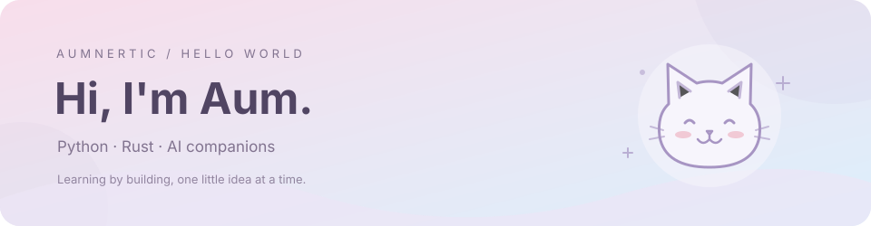

  <picture>
    <source media="(prefers-color-scheme: dark)" srcset="assets/header-dark.svg" />
    <source media="(prefers-color-scheme: light)" srcset="assets/header-light.svg" />
    
  </picture>

   

  
  

### 👋 关于我

这里是 **Aum / Aumnertic**，杭州师范大学在读。

- 🐱 正在做 [neko](https://github.com/Aumnertic/neko)，探索 AI 伙伴的记忆、上下文与角色互动。
- 🦀 用 **Rust** 探索核心运行时，用 **Python** 写应用和实用小工具。
- 🌱 在项目里边学边做，也在[博客](https://aumnertic.top/)记录。

### 🛠️ 常用技术

  
  
  
  

### ✨ 在做的东西

| 项目 | 简介 | 技术 |
| :--- | :--- | :--- |
| [🐱 neko](https://github.com/Aumnertic/neko) | AI 伙伴项目，连接 Rust 核心与 Python 应用 | Rust · Python |
| [🧠 neko-mind](https://github.com/Aumnertic/neko-mind) | AI 伙伴核心运行时，探索上下文与记忆管理，处于早期原型阶段 | Rust |
| [📦 vman-py](https://github.com/Aumnertic/vman-py) | 扫描、记录和检查 Python 虚拟环境的命令行工具 | Python · SQLite |

### 📊 GitHub 日常

  <picture>
    <source media="(prefers-color-scheme: dark)" srcset="assets/stats-dark.svg" />
    <source media="(prefers-color-scheme: light)" srcset="assets/stats-light.svg" />
    
  </picture>
  <picture>
    <source media="(prefers-color-scheme: dark)" srcset="assets/languages-dark.svg" />
    <source media="(prefers-color-scheme: light)" srcset="assets/languages-light.svg" />
    
  </picture>

    

  <picture>
    <source media="(prefers-color-scheme: dark)" srcset="assets/snake-dark.svg" />
    <source media="(prefers-color-scheme: light)" srcset="assets/snake-light.svg" />
    
  </picture>

一点一点，把想法变成代码。 (｡･ω･｡)ﾉ

<!-- 图片每日自动更新。配置见 .github/workflows/profile.yml。
     Stats: https://github.com/stats-organization/github-readme-stats-action
     Snake: https://github.com/Platane/snk -->
