  <picture>
    <source media="(prefers-color-scheme: dark)" srcset="assets/header-dark.svg" />
    <source media="(prefers-color-scheme: light)" srcset="assets/header-light.svg" />
    
  </picture>

嗨，我是 Aum，在杭州师范大学读书。

最近大部分时间都在折腾 [neko](https://github.com/Aumnertic/neko)，一个 AI 伙伴项目。想让它记得之前聊过什么，说话也像同一个角色，而不是每次都从头开始。核心部分用 Rust 写，应用和一些顺手的小工具用 Python。很多东西是边做边学的，有时候会写到[博客](https://aumnertic.top/)上。

**手上的项目**

- [neko](https://github.com/Aumnertic/neko)：AI 伙伴本体，Rust 核心加 Python 应用
- [neko-mind](https://github.com/Aumnertic/neko-mind)：neko 的运行时，负责上下文和记忆，还在很早期
- [vman-py](https://github.com/Aumnertic/vman-py)：扫描、记录、检查本机 Python 虚拟环境的命令行小工具

平时主要用 Python、Rust、uv 和 Git。

   
  <picture>
    <source media="(prefers-color-scheme: dark)" srcset="assets/stats-dark.svg" />
    <source media="(prefers-color-scheme: light)" srcset="assets/stats-light.svg" />
    
  </picture>
  <picture>
    <source media="(prefers-color-scheme: dark)" srcset="assets/languages-dark.svg" />
    <source media="(prefers-color-scheme: light)" srcset="assets/languages-light.svg" />
    
  </picture>

    

  <picture>
    <source media="(prefers-color-scheme: dark)" srcset="assets/snake-dark.svg" />
    <source media="(prefers-color-scheme: light)" srcset="assets/snake-light.svg" />
    
  </picture>

<!-- 图片每日自动更新。配置见 .github/workflows/profile.yml。
     Stats: https://github.com/stats-organization/github-readme-stats-action
     Snake: https://github.com/Platane/snk -->
