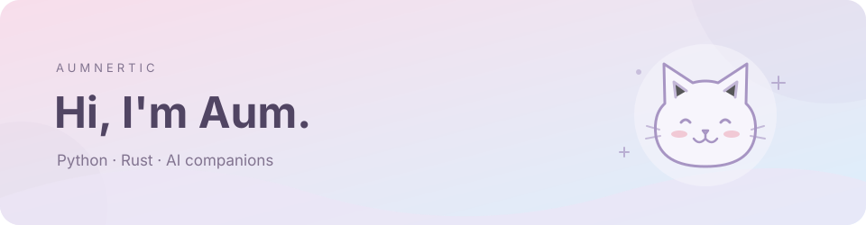
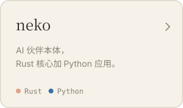
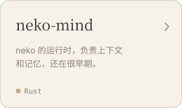
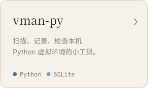

<picture>
  <source media="(prefers-color-scheme: dark)" srcset="assets/header-dark.svg" />
  
</picture>

嗨，我是 Aum。最近大部分时间都在折腾 [neko](https://github.com/Aumnertic/neko)，一个 AI 伙伴项目。想让它记得之前聊过什么，说话也像同一个角色，而不是每次都从头开始。很多东西是边做边学的，有时候会写到[博客](https://aumnertic.top/)上。

  <a href="https://github.com/Aumnertic/neko"><picture><source media="(prefers-color-scheme: dark)" srcset="assets/card-neko-dark.svg" /></picture></a>
  <a href="https://github.com/Aumnertic/neko-mind"><picture><source media="(prefers-color-scheme: dark)" srcset="assets/card-neko-mind-dark.svg" /></picture></a>
  <a href="https://github.com/Aumnertic/vman-py"><picture><source media="(prefers-color-scheme: dark)" srcset="assets/card-vman-py-dark.svg" /></picture></a>

<!-- 横幅和卡片由 scripts/make_assets.py 生成：改完文字后运行 python3 scripts/make_assets.py assets -->
