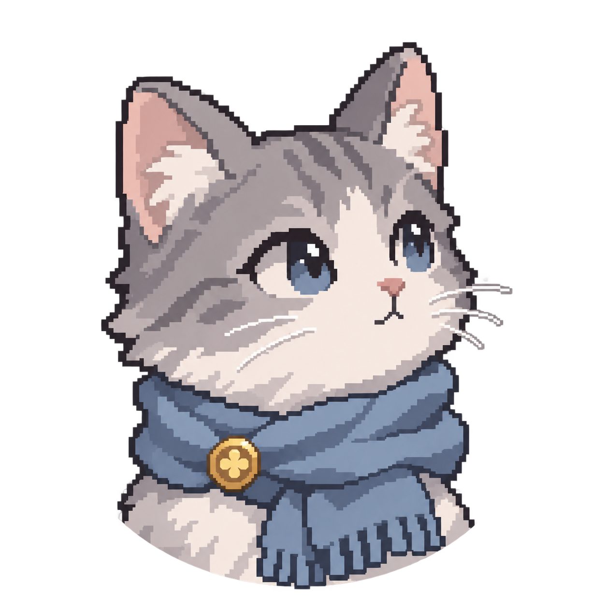
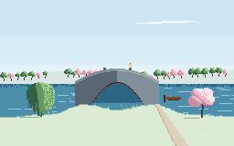
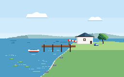
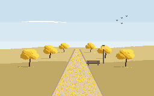
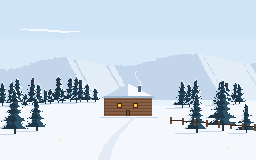

# 美术资产

## 猫猫头像

灰白虎斑、蓝眼睛、蓝色流苏围巾和金色四瓣花章是共同的识别点。花章别在画面左侧的围巾上，深金色圆心托着四个浅金圆瓣。博客用侧脸作作者头像，笔记站用读书猫作小图标、分享图和首页插画。书房里的猫延续同一套特征。

| 博客原头像 | 笔记站圆底原图 | 笔记站首页像素版 |
| :---: | :---: | :---: |
|  |  |  |
| [PNG](avatars/blog-original.png) · 1254 × 1254 | [PNG](avatars/notes-original.png) · 1254 × 1254 | [WebP](avatars/notes-home.webp) · 1254 × 1254 |

| 上线用途 | 文件 | 源文件 |
| --- | --- | --- |
| 博客作者卡、关于页 | [blog-avatar.webp](avatars/blog-avatar.webp) · 256 × 256 | [public/portraits/aum.webp][blog-avatar] |
| Notes 导航与 favicon | [notes-favicon.png](marks/notes-favicon.png) · 64 × 64 | [public/favicon.png][notes-icon] |
| Notes 分享预览 | [notes-original.png](avatars/notes-original.png) | [public/images/reading-cat.png][notes-avatar] |
| Notes 首页主图 | [notes-home.webp](avatars/notes-home.webp) | [public/images/notes-hero-cat.webp][notes-hero] |

博客原图来自工作区的 `output/imagegen/aum-avatar/aum-avatar.png`。透明像素版适合配独立底色或光晕，圆底图适合头像和分享图。

## 手写字标与四季风景

手写 A 来自完整字标的首字母。两站顶栏使用细笔画 A，浏览器图标使用粗笔画和纸色圆角底。完整 SVG 依照博客的宽头笔笔画导出，保留各季的墨色与 i 上的圆点，可以直接放到浅底上。[字标组件][wordmark] · [单字母组件][monogram] · [字标生成器][wordmark-tools]

| 主题 | 手写 A 图标 | Aumnertic 完整字标 | 首页通屏风景 | 博客页首风景 |
| --- | --- | --- | --- | --- |
| 晴春 | [SVG](marks/a-spring.svg) | [SVG](marks/wordmark-spring.svg) | [PNG](scenery/homepage/spring.png) · 春水与樱花 | [PNG](scenery/blog/spring.png) · 河畔水乡与石桥 |
| 晴夏 | [SVG](marks/a-summer.svg) | [SVG](marks/wordmark-summer.svg) | [PNG](scenery/homepage/summer.png) · 海湾、白帆与灯塔 | [PNG](scenery/blog/summer.png) · 积云、海岸与梯田 |
| 晴秋 | [SVG](marks/a-autumn.svg) | [SVG](marks/wordmark-autumn.svg) | [PNG](scenery/homepage/autumn.png) · 溪水、红桥与秋叶 | [PNG](scenery/blog/autumn.png) · 红枫、银杏与草垛 |
| 晴冬 | [SVG](marks/a-winter.svg) | [SVG](marks/wordmark-winter.svg) | [PNG](scenery/homepage/winter.png) · 湖、雪山、松树与暖窗 | [PNG](scenery/blog/winter.png) · 雪山与松林 |

首页背景为 720 × 450，把天空留给界面，让地平线、树和建筑贴在画面下缘。博客页首图为 640 × 320，雪线、树群和河道用色块分出前后，低处渐入纸色。生成脚本先画语义索引图，再套用季节调色板，用 Bayer 有序抖动连接天空色带。晴冬以右侧受光、松林背影和局部暖窗给雪景增加层次。[首页背景源文件][home-scenery] · [博客风景源文件][blog-scenery] · [博客风景生成器][scenery-tools]

## 博客小景与页脚

每季六张 256 × 160 小景，用于文章卡片与作者头像的背景。列表从最旧文章开始按序轮换图案，每篇文章在四季有对应的版本。页脚是 640 × 72 的窄幅风景，可横向平铺。[24 张小景](scenery/blog/cards/) · [小景分配逻辑][card-scene] · [博客页脚][blog-footer]

| 晴春 | 晴夏 | 晴秋 | 晴冬 |
| --- | --- | --- | --- |
|  |  |  |  |
| [春季页脚](scenery/blog/footer-spring.png) | [夏季页脚](scenery/blog/footer-summer.png) | [秋季页脚](scenery/blog/footer-autumn.png) | [冬季页脚](scenery/blog/footer-winter.png) |

## 书房插画与配乐

- **湖畔书房。** 主卡片使用 1000 × 563 的插画。窗外是远山和湖面，室内有猫、书、电脑与暖灯，画面可按 16:9 使用。[书房 WebP](scenery/homepage/atelier.webp) · [源文件][atelier]
- **《湖畔晨光》。** 首页原创合成配乐，MP3，约 56 秒。访客可以点播并查看进度。[配乐 MP3](audio/lakeside-morning.mp3) · [源文件][audio-source] · [首页说明][home-readme]
- **旧版整页背景。** 归档在首页源仓库的 `bg.webp`。[旧版背景][old-bg]

[blog-avatar]: https://github.com/Aumnertic/blog-minimal/blob/d593eccd5e5d7b8740fee98e1b5267bf02cd9bdf/public/portraits/aum.webp
[notes-icon]: https://github.com/Aumnertic/notes-repo/blob/b4b71455e0107f0d836dc49ca2d4ce42033b4a28/public/favicon.png
[notes-avatar]: https://github.com/Aumnertic/notes-repo/blob/b4b71455e0107f0d836dc49ca2d4ce42033b4a28/public/images/reading-cat.png
[notes-hero]: https://github.com/Aumnertic/notes-repo/blob/b4b71455e0107f0d836dc49ca2d4ce42033b4a28/public/images/notes-hero-cat.webp
[wordmark]: https://github.com/Aumnertic/blog-minimal/blob/d593eccd5e5d7b8740fee98e1b5267bf02cd9bdf/src/components/Wordmark.astro
[monogram]: https://github.com/Aumnertic/blog-minimal/blob/d593eccd5e5d7b8740fee98e1b5267bf02cd9bdf/src/components/Monogram.astro
[wordmark-tools]: https://github.com/Aumnertic/blog-minimal/tree/d593eccd5e5d7b8740fee98e1b5267bf02cd9bdf/tools/wordmark
[home-scenery]: https://github.com/Aumnertic/homepage/tree/9fc0ed2c47fc3f0df83d2cfdc3a703c77f4134a3/assets/scenery
[blog-scenery]: https://github.com/Aumnertic/blog-minimal/tree/d593eccd5e5d7b8740fee98e1b5267bf02cd9bdf/public/scenery
[scenery-tools]: https://github.com/Aumnertic/blog-minimal/tree/d593eccd5e5d7b8740fee98e1b5267bf02cd9bdf/tools/scenery
[card-scene]: https://github.com/Aumnertic/blog-minimal/blob/d593eccd5e5d7b8740fee98e1b5267bf02cd9bdf/src/lib/scene.ts
[blog-footer]: https://github.com/Aumnertic/blog-minimal/blob/d593eccd5e5d7b8740fee98e1b5267bf02cd9bdf/src/components/Footer.astro
[atelier]: https://github.com/Aumnertic/homepage/blob/9fc0ed2c47fc3f0df83d2cfdc3a703c77f4134a3/assets/atelier.webp
[audio-source]: https://github.com/Aumnertic/homepage/blob/9fc0ed2c47fc3f0df83d2cfdc3a703c77f4134a3/assets/lakeside-morning.mp3
[home-readme]: https://github.com/Aumnertic/homepage/blob/9fc0ed2c47fc3f0df83d2cfdc3a703c77f4134a3/README.md
[old-bg]: https://github.com/Aumnertic/homepage/blob/9fc0ed2c47fc3f0df83d2cfdc3a703c77f4134a3/bg.webp
