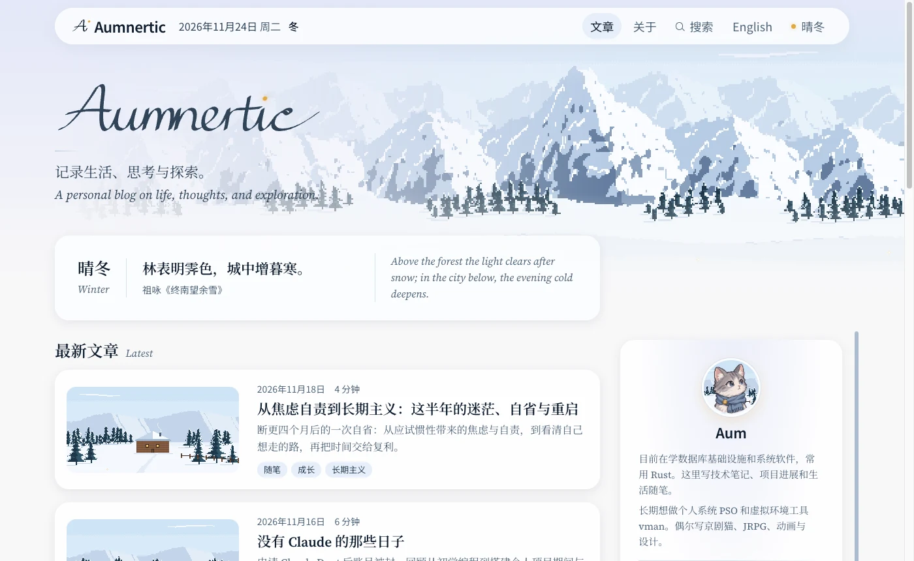
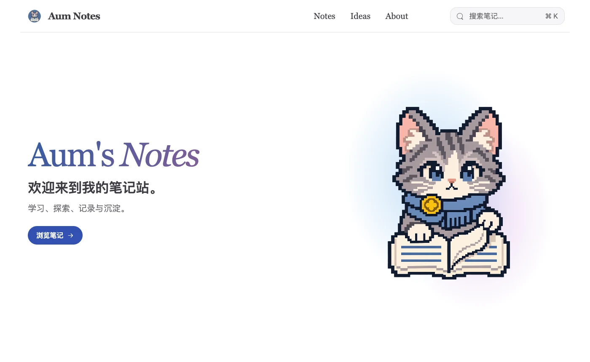

# 视觉与设计语言

首页和博客用像素风景表现季节，再用同一套配色连接天空、纸面和控件。笔记站把插画集中在首页，阅读页靠中性表面、细线和导航组织信息。

| 首页 晴冬 | 博客 晴冬 | Aum Notes 浅色 |
| --- | --- | --- |
|  |  |  |

样张使用 1400 × 860 的本地桌面视口，首页爱心数为示例值。

## 首页与博客

两站共用手写 A、浅色纸面、深墨字、胶囊顶栏和同色浅阴影。窗灯、花瓣、红桥一类的暖色细节留在画里，导航与正文链接用强调色。小圆点取季节色，完整的 Aumnertic 手写字标用于博客刊头。[首页样式][home-css] · [博客样式][blog-css] · [字标笔画][strokes]

### 四季色板

| CSS 变量 | 晴春 | 晴夏 | 晴秋 | 晴冬 | 用途 |
| --- | --- | --- | --- | --- | --- |
| `--paper` | `#f7faf6` | `#f5fafb` | `#faf7f2` | `#f6f9fc` | 基础纸色 |
| `--ink` | `#12231d` | `#0d222c` | `#231915` | `#0f1d2e` | 主文字和 A 字标 |
| `--ink-2` | `#2d463c` | `#254452` | `#44332b` | `#304459` | 引语和手写刊头 |
| `--muted` | `#4a6359` | `#41616e` | `#634f45` | `#516579` | 摘要、日期、辅助信息 |
| `--accent` | `#216649` | `#0e6280` | `#9c3d1c` | `#1b5a94` | 链接、交互与键盘焦点 |
| `--sun` | `#d46b82` | `#eb7f22` | `#c9402e` | `#e2a740` | 字标圆点和主题提示 |
| `--rule` | `#d4e3da` | `#cfe2e8` | `#e5dcd1` | `#d8e3ee` | 细分隔线 |
| `--select` | `#d2e7da` | `#cde6f2` | `#eedcc8` | `#cfe2f5` | 文本选中与控件状态 |
| `--card` | `#fcfefd` | `#fcfeff` | `#fdfbf8` | `#fdfeff` | 浅色卡片底 |
| `--code-bg` | `#e9f2ec` | `#e6f2f6` | `#f1eae0` | `#e8eff7` | 博客代码块底色 |

四立决定首次默认季节，顶栏按钮按冬、春、夏、秋循环。风景、色板、字标圆点和 favicon 一起换色。手选主题各自保存在对应站点的浏览器存储中。复用配色时按变量用途取色，实际面板用 `--card` 混合透明色，页底由 `--page-paper` 调色。[首页主题][home-html] · [博客主题][blog-layout]

### 排版、布局与交互

首页与博客用 Source Serif 4 和 Noto Serif SC 排标题与正文，导航、日期和标签用 Noto Sans SC。像素颗粒集中在插画里，文字靠字级、行距和留白区分层级。[首页样式][home-css] · [博客样式][blog-css]

- **个人主页。** 宽屏把书房插画、英文问候和联系方式放在中间，文章与项目在左，时钟、近况和月历在右。背景按视口铺开，把地平线压低，左、右缘和下缘保留树、桥与暖窗。卡片圆角 `1.35rem`，悬停抬高 `2px`，位移和阴影用 `160ms`。两栏时把主卡移到上方，手机再叠成一列。配乐由访客点播。[首页布局][home-html] · [首页样式][home-css]
- **博客。** 完整字标和引言靠左，像素风景向左和下缘淡入纸面。季节诗句承上，文章卡片按日期排列，摘要和标签与缩略图并列，作者简介与标签在右。内页以 `54rem` 阅读栏为中心，大纲宽屏放左栏、窄屏放正文上方。正文为桌面 `20px`、手机 `18px`，行高 `1.8`，代码用等宽字。从列表点进文章时，所点击的标题移动到正文标题的位置，主要过渡时长 `560ms`。[博客首页样式][blog-home-css] · [博客阅读样式][blog-css] · [文章页][blog-post]

## Aum Notes

首页左边是 Georgia 衬线标题、欢迎语和一个主按钮，右边是透明底翻页像素猫。浅色标题渐变为 `#365ba1` 到 `#805e98`，深色为 `#a9c6ff` 到 `#dcb8ee`。猫身后的淡蓝与浅紫光晕由 CSS 绘制。笔记正文和阅读页标题使用系统无衬线字，代码块按主题使用对应的 Shiki 高亮。[笔记站首页][notes-home] · [全局样式][notes-css] · [高亮配置][notes-config]

| CSS 变量 | 浅色 | 深色 | 用途 |
| --- | --- | --- | --- |
| `--paper` | `#ffffff` | `#1c1c1e` | 背景与正文表面 |
| `--surface` | `#f6f6f7` | `#27272b` | 搜索与控件表面 |
| `--sidebar-surface` | `#f6f6f7` | `#222226` | 专题侧栏 |
| `--ink` | `#3c3c43` | `#eaeaec` | 主文字 |
| `--muted` | `#67676c` | `#b4b4bc` | 日期与辅助文字 |
| `--accent` | `#3351b2` | `#a7b5ff` | 链接、选中态与焦点 |
| `--line` | `#e2e2e3` | `#3a3a40` | 导航、列表和阅读区细线 |

- **阅读界面。** 顶栏固定在滚动顶部，目录页和正文页共用 `17.25rem` 左栏。正文最宽 `52rem`，面包屑和本页大纲随阅读保留在上方。窄屏用菜单承接专题导航。列表用细线划分行，当前专题和笔记用背景与强调色定位。[深色阅读页样张](previews/notes-reading-dark.webp) · [全局样式][notes-css] · [阅读样式][notes-reading]
- **动效。** 项目以 Apple 产品的交互质感作参考。控件反馈 `160ms`，菜单、下划线和折叠 `320ms`，页面过渡 `440ms`。专题和笔记之间保留顶栏与侧栏的连续性，导航指示线和列表标题参与过渡。主图在细指针设备上小幅跟随光标，主题按钮在支持的浏览器上从按钮位置展开色面。三站都响应系统减少动效设置，交互控件保留可见键盘焦点。[笔记站项目原则][notes-agents] · [过渡样式][notes-css] · [主题按钮][notes-theme]

[home-css]: https://github.com/Aumnertic/homepage/blob/9fc0ed2c47fc3f0df83d2cfdc3a703c77f4134a3/styles.css
[home-html]: https://github.com/Aumnertic/homepage/blob/9fc0ed2c47fc3f0df83d2cfdc3a703c77f4134a3/index.html
[blog-css]: https://github.com/Aumnertic/blog-minimal/blob/d593eccd5e5d7b8740fee98e1b5267bf02cd9bdf/src/styles/global.css
[blog-home-css]: https://github.com/Aumnertic/blog-minimal/blob/d593eccd5e5d7b8740fee98e1b5267bf02cd9bdf/src/styles/home.css
[blog-layout]: https://github.com/Aumnertic/blog-minimal/blob/d593eccd5e5d7b8740fee98e1b5267bf02cd9bdf/src/layouts/BaseLayout.astro
[blog-post]: https://github.com/Aumnertic/blog-minimal/blob/d593eccd5e5d7b8740fee98e1b5267bf02cd9bdf/src/pages/posts/%5Bslug%5D.astro
[strokes]: https://github.com/Aumnertic/blog-minimal/blob/d593eccd5e5d7b8740fee98e1b5267bf02cd9bdf/tools/wordmark/strokes.py
[notes-home]: https://github.com/Aumnertic/notes-repo/blob/b4b71455e0107f0d836dc49ca2d4ce42033b4a28/src/pages/index.astro
[notes-css]: https://github.com/Aumnertic/notes-repo/blob/b4b71455e0107f0d836dc49ca2d4ce42033b4a28/src/styles/global.css
[notes-reading]: https://github.com/Aumnertic/notes-repo/blob/b4b71455e0107f0d836dc49ca2d4ce42033b4a28/src/styles/reading.css
[notes-config]: https://github.com/Aumnertic/notes-repo/blob/b4b71455e0107f0d836dc49ca2d4ce42033b4a28/astro.config.mjs
[notes-agents]: https://github.com/Aumnertic/notes-repo/blob/b4b71455e0107f0d836dc49ca2d4ce42033b4a28/AGENTS.md
[notes-theme]: https://github.com/Aumnertic/notes-repo/blob/b4b71455e0107f0d836dc49ca2d4ce42033b4a28/src/components/ThemeToggle.astro
